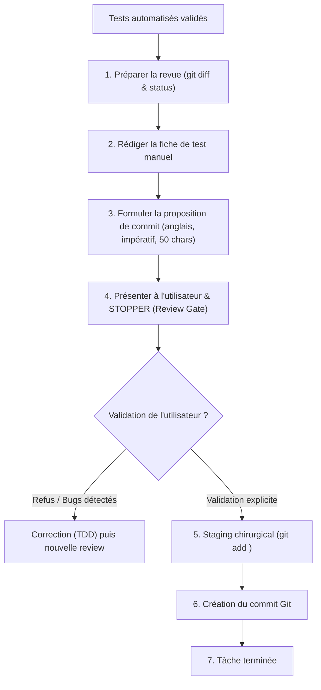

# Human Review & Commit Protocol

Ce skill formalise le point d'arrêt humain et la création de commits Git cohérents et atomiques une fois qu'un ticket ou une tâche de code est implémentée et que les vérifications automatisées sont vertes.

---

## Processus d'Exécution



---

### Phase 1 : Inspection du Diff & Préparation

Avant de s'adresser à l'utilisateur :
1. Vérifier l'état de l'arbre de travail :
   ```bash
   git status --porcelain
   git diff --stat
   ```
2. Contrôler que **seuls** les fichiers prévus dans le ticket (`## Expected Outputs`) ou nécessaires à la tâche ont été altérés.
3. Vérifier que la branche de travail courante est appropriée (`git branch --show-current`).

---

### Phase 2 : Rédaction de la Fiche de Test Manuel

Rédiger pour l'utilisateur une procédure de test clair, synthétique et reproductible, sans jargon inutile :

```markdown
### 📋 Fiche de Revue Manuelle

* **Impact fonctionnel :** <Résumé en 1-2 phrases de ce qui change pour l'application / l'utilisateur>
* **Fichiers modifiés :** <Liste synthétique des fichiers concernés>

#### Étapes de Test Manuel
1. **Pré-requis :** <Ex: Serveur dev lancé via `npm run dev`, base migrée, etc.>
2. **Action(s) à réaliser :** <Ex: Ouvrir la page `/settings`, cliquer sur "Modifier le mot de passe", entrer une valeur de moins de 8 caractères>
3. **Comportement attendu :** <Ex: Le message d'erreur "Password too short" s'affiche immédiatement en rouge, le bouton "Enregistrer" reste désactivé>
4. **Point de vigilance :** <Ex: Vérifier que la console navigateur ne signale pas d'erreur 500>
```

---

### Phase 3 : Rédaction de la Proposition de Commit

Rédiger un brouillon de message de commit respectant strictement les 3 règles d'or :

#### Règle 1 : Structure & Format du Sujet
* Rédigé obligatoirement en **anglais** au **mode impératif** (ex: `Add feature`, `Fix bug`, `Refactor auth logic`).
* Ne jamais utiliser de passé (`Added`, `Fixed`) ni de gérondif (`Adding`, `Fixing`).
* Valider impérativement le titre avec le test mental :
  > *"If applied, this commit will [sujet du commit]"*
* Commencer par une majuscule, **aucun point final**.
* Longueur maximale absolue du titre : **50 caractères**.
* Séparer le titre du corps par **exactement une ligne vide**.

#### Règle 2 : Corps du Message (WHAT & WHY)
* Se concentrer exclusivement sur le **QUOI** et le **POURQUOI** :
  * Contexte et problème initial.
  * Raison du changement.
  * Justification de la solution retenue et éventuels arbitrages.
* **Interdiction de décrire le COMMENT :** Le diff du code l'exprime déjà.

#### Règle 3 : Atomicité
* Un seul changement logique par commit (ne jamais mixer un refactoring structurel et un ajout de feature).

#### Exemple de Message Conforme :
```text
Add length validation to user password field

Users could previously submit passwords of arbitrary length,
leading to potential hashing timeouts and weak credential storage.
This enforces an 8-character minimum threshold before form submission
to align with the security requirements in ADR 0002.
```

---

### Phase 4 : Point d'Arrêt Humain (*Review Gate*)

Présenter la fiche de test manuel et la proposition de commit à l'utilisateur, puis **s'arrêter immédiatement** en posant la question de validation :

> *"Veuillez réaliser le test manuel ci-dessus. Le résultat est-il conforme à vos attentes ? Confirmez pour que je procède au commit Git, ou indiquez-moi les ajustements nécessaires."*

⚠️ **Interdiction absolue d'exécuter `git commit` à cette étape.**

---

### Phase 5 : Exécution du Commit Sécurisé (Post-Validation)

Une fois la confirmation explicite de l'utilisateur reçue :
1. **Staging Chirurgical Obligatoire :**
   * Ajouter explicitement les fichiers concernés un par un :
     ```bash
     git add <chemin/fichier1> <chemin/fichier2>
     ```
   * **Interdiction formelle** de lancer `git add .` ou `git add -A` afin d'éviter tout commit accidentel d'artefacts temporaires (`.agents/tmp/`).
2. **Création du Commit :**
   ```bash
   git commit -m "<Subject (max 50 chars)>" -m "<Body expliquant What et Why>"
   ```
3. **Affichage du Résultat :**
   * Présenter à l'utilisateur le hash SHA-1 court et le sujet du commit créé.
   * Proposer la purge des fichiers temporaires associés dans `.agents/tmp/`.
