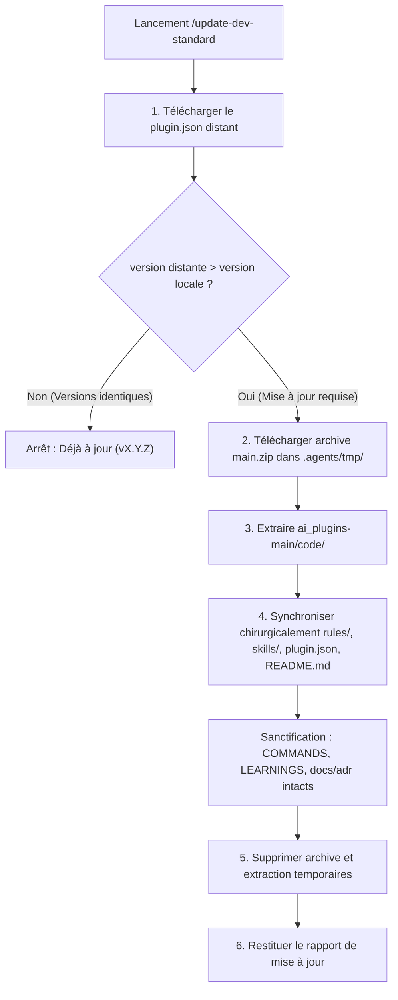

# Update Dev Standard Protocol

Ce skill assure la mise à jour déterministe, chirurgicale et idempotente du moteur du plugin `dev-standard` au sein d'un projet cible, en synchronisant ses composants depuis le dépôt GitHub officiel (`Nath-Hane/ai_plugins`) tout en sanctuarisant les fichiers d'état du projet.

---

## 1. Paramètres & Source de Vérité

* **Dépôt GitHub :** `https://github.com/Nath-Hane/ai_plugins`
* **Branche par défaut :** `main`
* **Sous-dossier du plugin :** `code`
* **URL du Manifeste distant :**
  `https://raw.githubusercontent.com/Nath-Hane/ai_plugins/main/code/plugin.json`
* **URL de l'Archive GitHub :**
  `https://github.com/Nath-Hane/ai_plugins/archive/refs/heads/main.zip`

---

## 2. Procédure Séquentielle Déterministe



---

### Étape 1 : Vérification Préalable de Version (Court-Circuit Idempotent)

1. Localiser le fichier `plugin.json` local du plugin dans le projet (généralement `.agents/plugins/dev-standard/plugin.json` ou le chemin d'installation actif).
2. Lire la version locale installée (`local_version`).
3. Télécharger le `plugin.json` distant via `curl` ou requête HTTP :
   ```bash
   curl -sS https://raw.githubusercontent.com/Nath-Hane/ai_plugins/main/code/plugin.json -o .agents/tmp/remote-plugin.json
   ```
4. Comparer les versions :
   * Si `remote_version == local_version` :
     Nettoyer `.agents/tmp/remote-plugin.json` et informer l'utilisateur :
     > *"Le plugin dev-standard est déjà à jour (version vX.Y.Z). Aucune modification nécessaire."*
     **Arrêter le processus ici.**

---

### Étape 2 : Téléchargement Isolé dans le Scratchpad

1. Si une version plus récente est disponible, télécharger l'archive du dépôt dans `.agents/tmp/` :
   ```bash
   curl -L -sS https://github.com/Nath-Hane/ai_plugins/archive/refs/heads/main.zip -o .agents/tmp/ai_plugins_update.zip
   ```
2. Décompresser l'archive dans un répertoire temporaire dédié :
   `.agents/tmp/extracted_update/`

---

### Étape 3 : Extraction Ciblée du Sous-Dossier `code/`

Localiser le sous-dossier cible dans l'archive décompressée :
`ai_plugins-main/code/` (ou `<archive-root>/code/`).

Vérifier la présence impérative de `code/plugin.json` et `code/rules/AGENTS.md` pour garantir l'intégrité du téléchargement.

---

### Étape 4 : Synchronisation Chirurgicale du Moteur

Copier **exclusivement** les composants du moteur vers le dossier d'installation du plugin dans le projet :

1. `code/rules/AGENTS.md` ➜ `<plugin_dir>/rules/AGENTS.md`
2. `code/skills/**` ➜ `<plugin_dir>/skills/`
3. `code/plugin.json` ➜ `<plugin_dir>/plugin.json`
4. `code/README.md` ➜ `<plugin_dir>/README.md`

#### 🛡️ Règle Absolue de Sanctification (Ne JAMAIS Toucher) :
* `.agents/COMMANDS.md`
* `.agents/LEARNINGS.md`
* `.agents/CONVENTIONS.md`
* `docs/adr/**`
* `.agents/docs/**` et son `INDEX.md`
* `.scratch/**`

Ces fichiers appartiennent à l'instance du projet et ne doivent sous aucun prétexte être écrasés lors d'une mise à jour de `dev-standard`.

---

### Étape 5 : Nettoyage Déterministe

Supprimer immédiatement l'archive ZIP et les dossiers d'extraction temporaires créés dans `.agents/tmp/` :
* `.agents/tmp/ai_plugins_update.zip`
* `.agents/tmp/extracted_update/`
* `.agents/tmp/remote-plugin.json`

---

### Étape 6 : Rapport de Clôture

Afficher à l'utilisateur :
* La version précédente et la nouvelle version installée.
* La liste des fichiers du moteur mis à jour (`rules/AGENTS.md`, nouvelles compétences éventuelles).
* La confirmation que tous les fichiers spécifiques au projet (`LEARNINGS.md`, `COMMANDS.md`, ADRs) sont restés intacts.
